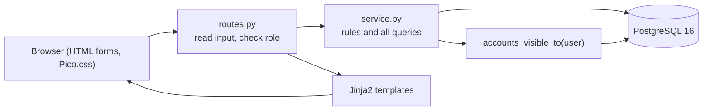
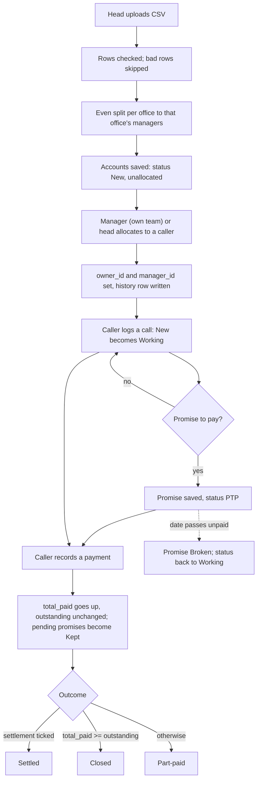

# Shaha Finlease LMS prototype

A small recovery loan-management system for a debt-buying NBFC. The accounts are already
bought; the system tracks who owns each account, the calls made, the promises to pay and
the payments received. All data is dummy data.

## Features and roles

- Head uploads accounts from a CSV (100,000 rows in about 30 seconds) and allocates to any caller.
- Managers allocate and reassign within their own team, manually or with auto-allocate.
- Callers work a queue (today's follow-ups first), log calls, promises and payments.
- Search by customer name, mobile or loan number. 50 accounts per page.
- Promises become Broken automatically when the date passes without payment.

| Role | Sees | Can do |
|---|---|---|
| caller | own accounts | log calls, promises and payments on own open accounts |
| manager | own team's accounts and callers | allocate, reassign, auto-allocate; read-only on calls and payments |
| head | everything | upload CSV, allocate to any caller |
| coo | everything | read only |
| customer_service | own office | read-only list, search and account page |

## Architecture



## Data flow



## Tech stack

Python 3.12, FastAPI, Jinja2 templates (no JavaScript), Pico.css from a CDN,
SQLAlchemy 2.x, PostgreSQL 16, psycopg 3, bcrypt, Starlette sessions, pytest.
Everything runs in Docker Compose.

## Project structure

```
app/
  main.py            app, session middleware, routers
  core/              config, database, security (bcrypt), deps (current user, require_role), constants
  models/            one SQLAlchemy model per table
  features/
    auth/            login and logout
    upload/          CSV upload (head only)
    accounts/        list, search, account page, visibility rules
    allocation/      manual and automatic allocation
    calls/           call log
    promises/        create, Kept and Broken rules
    payments/        payments and status changes
  templates/         Jinja2 pages
  static/            style.css
scripts/             seed, reset_demo, make_big_csv, backdate_promises
tests/               role, upload, allocation and payment tests
data/                users_seed.csv, accounts_10000.csv
Dockerfile, docker-compose.yml, entrypoint.sh, requirements.txt
```

## Quick start

```
docker compose up --build
```

Open http://localhost:8000. No `.env` file is needed; compose has safe defaults
(`.env.example` shows the variables). On first start the database is filled with
offices, users and 10,000 accounts.

## Demo logins

The password for every user is `demo123`.

| Role | Usernames |
|---|---|
| head | `head` |
| coo | `coo` |
| manager | `manager1` to `manager7` |
| caller | `caller1` to `caller60` |
| customer_service | `cs1` to `cs3` |

## Resetting the demo

```
docker compose exec app python -m scripts.reset_demo
docker compose exec app python -m scripts.reset_demo --no-accounts
```

The first drops all tables, creates them again and loads users and the 10,000 accounts.
The second does the same but skips the accounts, so you can upload them as the head.

## Running tests

```
docker compose exec app pytest -q
docker compose exec app pytest -m slow
```

The first runs the normal tests. The second runs the slow 100,000-row upload test.
Tests reset the database first.

## Assumptions

- Only the head can upload.
- At upload, each office's accounts are split evenly between that office's managers.
- A manager allocates only within their own team; the head can allocate to anyone.
- The head cannot use auto-allocate; it is for managers only.
- The COO has a read-only view of everything.
- Customer service is read-only and sees only their own office.
- Any payment on or before the promise date marks the promise Kept.
- Closed and Settled accounts are final: no more calls or payments.
- Accounts a user is not allowed to see show a 404 page.
- The upload always forces status New, total paid 0 and no owner.
- A bad date or a negative amount makes the row a bad row, and it is skipped.
- A duplicate loan number inside one file counts as a duplicate.
- Allocation history is written for caller allocations only, not for the manager split at upload.
- All users share the demo password.
- No CSRF protection (prototype).
- Tests reset the database.
