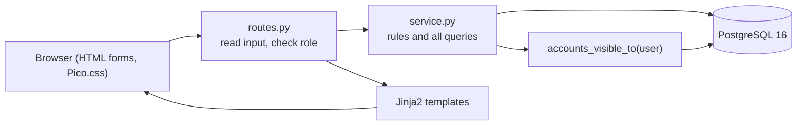
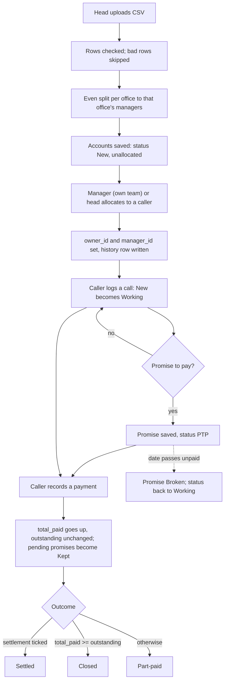

# Shaha Finlease LMS prototype

A small recovery loan-management system for a debt-buying NBFC. The accounts are already
bought; the system tracks who owns each account, the calls made, the promises to pay and
the payments received. All data is dummy data.

## Features and roles

- Head uploads accounts from a CSV (100,000 rows in about 30 seconds) and allocates to any caller.
- Managers allocate and reassign within their own team, manually or with auto-allocate.
- Callers work a queue (today's follow-ups first), log calls, promises and payments.
- Search by customer name, mobile or loan number. 50 accounts per page.
- Promises become Broken automatically when the date passes without payment.

| Role | Sees | Can do |
|---|---|---|
| caller | own accounts | log calls, promises and payments on own open accounts |
| manager | own team's accounts and callers | allocate, reassign, auto-allocate; read-only on calls and payments |
| head | everything | upload CSV, allocate to any caller |
| coo | everything | read only |
| customer_service | own office | read-only list, search and account page |

## Architecture



## Data flow



## Tech stack

Python 3.12, FastAPI, Jinja2 templates (no JavaScript), Pico.css from a CDN,
SQLAlchemy 2.x, PostgreSQL 16, psycopg 3, bcrypt, Starlette sessions, pytest.
Everything runs in Docker Compose.

## Project structure

```
app/
  main.py            app, session middleware, routers
  core/              config, database, security (bcrypt), deps (current user, require_role), constants
  models/            one SQLAlchemy model per table
  features/
    auth/            login and logout
    upload/          CSV upload (head only)
    accounts/        list, search, account page, visibility rules
    allocation/      manual and automatic allocation
    calls/           call log
    promises/        create, Kept and Broken rules
    payments/        payments and status changes
  templates/         Jinja2 pages
  static/            style.css
scripts/             seed, reset_demo, make_big_csv, backdate_promises
tests/               role, upload, allocation and payment tests
data/                users_seed.csv, accounts_10000.csv
Dockerfile, docker-compose.yml, entrypoint.sh, requirements.txt
```

## Quick start

You do not need Python, PostgreSQL or Node on your computer. You only need Git and Docker.

### 1. Prerequisites

| Needed | Why | Notes |
|---|---|---|
| Git | download the code | any recent version |
| Docker with Docker Compose v2 | runs the app and the database | Docker Desktop (Windows, macOS) already includes Compose; on Linux use Docker Engine with the Compose plugin |
| Free port 8000 | the app opens here | stop anything else that uses it |
| Internet and about 2 GB of disk | pulls the Python and PostgreSQL images; the page style loads from a CDN | first start only |

On Windows, Docker Desktop needs WSL 2 and CPU virtualization turned on in the BIOS. Its installer sets up WSL 2 and may ask for a restart.

### 2. Install Git and Docker

Windows (PowerShell), or use the links below:

```
winget install -e --id Git.Git
winget install -e --id Docker.DockerDesktop
```

Restart if asked, then open Docker Desktop and wait until it says it is running.

macOS (Homebrew), or use the links below:

```
brew install git
brew install --cask docker
```

Open the Docker app once and wait until it says it is running.

Linux (Ubuntu or Debian):

```
sudo apt update && sudo apt install -y git curl
curl -fsSL https://get.docker.com | sudo sh
sudo usermod -aG docker $USER
```

Log out and back in so the `docker` group applies. Other Linux distributions: follow the Docker Engine guide.

Official guides:
- Git: https://git-scm.com/downloads
- Docker Desktop for Windows: https://docs.docker.com/desktop/setup/install/windows-install/
- Docker Desktop for macOS: https://docs.docker.com/desktop/setup/install/mac-install/
- Docker Engine for Linux: https://docs.docker.com/engine/install/

Check that everything is installed (each command should print a version):

```
git --version
docker --version
docker compose version
```

### 3. Get the code

```
git clone https://github.com/vineet416/recovery-lms-prototype.git
cd recovery-lms-prototype
```

### 4. Start the app

```
docker compose up --build
```

The first start takes a few minutes: it downloads the images, builds the app and fills the
database with offices, users and 10,000 accounts. It is ready when the log shows
`Uvicorn running on http://0.0.0.0:8000`. No `.env` file is needed; compose has safe defaults
(`.env.example` shows the variables). To run it in the background instead, use
`docker compose up --build -d` and watch it with `docker compose logs -f app`.

### 5. Open it and log in

1. Open http://localhost:8000 in a browser.
2. Log in as `head` with password `demo123` (all logins are in the table below).
3. Click **Accounts**. You should see 10,000 accounts, 50 per page.

### 6. Stop it

Press Ctrl+C in the terminal (or run `docker compose down` from the project folder). To also delete
the database, run `docker compose down -v`; the next start loads fresh demo data.

### Troubleshooting

- `Cannot connect to the Docker daemon`: start Docker Desktop (Windows, macOS) or run `sudo systemctl start docker` (Linux).
- `permission denied` on `/var/run/docker.sock` (Linux): finish the `usermod` step and log in again, or put `sudo` before the command.
- `port is already allocated` or `address already in use`: another program uses port 8000. Stop it, or change `8000:8000` to `8001:8000` in `docker-compose.yml` and open http://localhost:8001.
- Windows says virtualization or WSL 2 is missing: turn on virtualization in the BIOS, then run `wsl --update` and restart.

## Demo logins

The password for every user is `demo123`.

| Role | Usernames |
|---|---|
| head | `head` |
| coo | `coo` |
| manager | `manager1` to `manager7` |
| caller | `caller1` to `caller60` |
| customer_service | `cs1` to `cs3` |

## Resetting the demo

```
docker compose exec app python -m scripts.reset_demo
docker compose exec app python -m scripts.reset_demo --no-accounts
```

The first drops all tables, creates them again and loads users and the 10,000 accounts.
The second does the same but skips the accounts, so you can upload them as the head.

To try the upload yourself, run the second command, log in as `head`, open **Upload** and choose
`data/accounts_10000.csv`. For the 100,000-row test, create the big file first (it is not stored
in Git) and upload it the same way:

```
docker compose exec app python -m scripts.make_big_csv
```

This writes `data/big_accounts.csv`.

## Running tests

```
docker compose exec app pytest -q
docker compose exec app pytest -m slow
```

The first runs the normal tests. The second runs the slow 100,000-row upload test.
Tests reset the database first.

## Assumptions

- Only the head can upload.
- At upload, each office's accounts are split evenly between that office's managers.
- A manager allocates only within their own team; the head can allocate to anyone.
- The head cannot use auto-allocate; it is for managers only.
- The COO has a read-only view of everything.
- Customer service is read-only and sees only their own office.
- Any payment on or before the promise date marks the promise Kept.
- Closed and Settled accounts are final: no more calls or payments.
- Accounts a user is not allowed to see show a 404 page.
- The upload always forces status New, total paid 0 and no owner.
- A bad date or a negative amount makes the row a bad row, and it is skipped.
- A duplicate loan number inside one file counts as a duplicate.
- Allocation history is written for caller allocations only, not for the manager split at upload.
- All users share the demo password.
- No CSRF protection (prototype).
- Tests reset the database.
